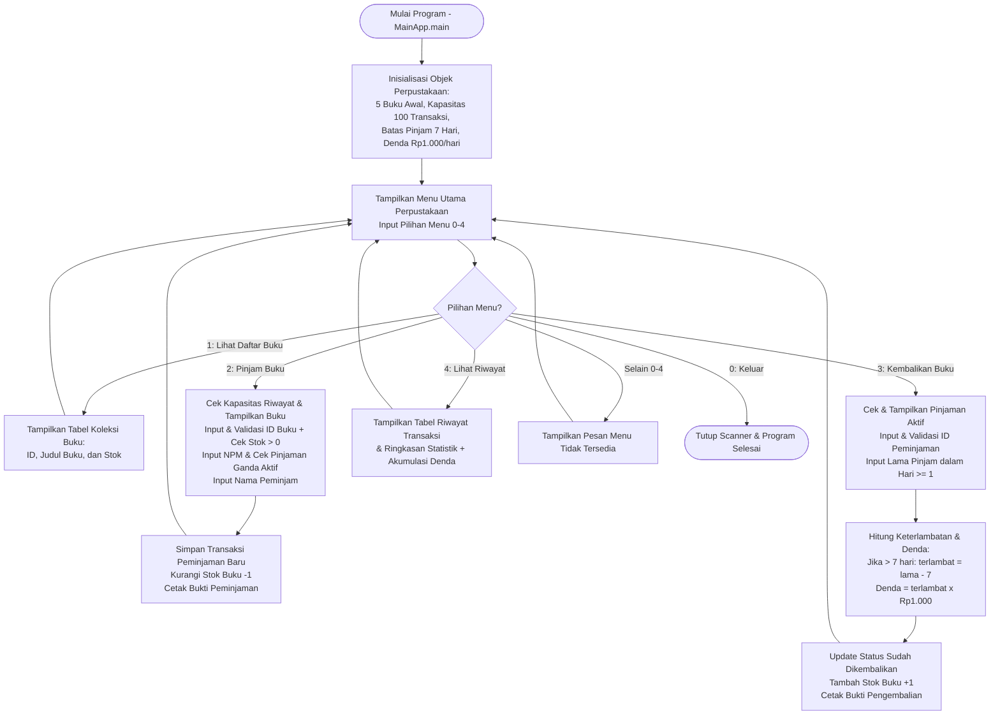

# Sistem Informasi Perpustakaan Sederhana (Kelompok 3)

Program aplikasi perpustakaan berbasis konsol (CLI) menggunakan bahasa pemrograman **Java** untuk mengelola daftar koleksi buku, transaksi peminjaman, transaksi pengembalian beserta perhitungan denda keterlambatan, dan laporan riwayat transaksi.

---

## Struktur File Program

- `MainApp.java` — *Entry point* program (`main` method) untuk menginisialisasi dan menjalankan aplikasi perpustakaan.
- `Buku.java` — *Class model* untuk merepresentasikan data buku (`idBuku`, `judulBuku`, `stokBuku`).
- `Peminjaman.java` — *Class model* untuk merepresentasikan data transaksi peminjaman (`idPeminjaman`, `npmPeminjam`, `namaPeminjam`, `indeksBuku`, `sudahDikembalikan`, `lamaPinjamHari`, `totalDenda`).
- `Perpustakaan.java` — *Class* utama yang memuat logika layanan perpustakaan, validasi input, serta tampilan menu dan tabel.

---

## Flow Program

### Diagram Alur (Flowchart)



### Penjelasan Alur Program

1. **Inisialisasi Program (`MainApp.java` & `Perpustakaan.java`)**
   - Program dimulai dari method `main()` pada `MainApp` yang membuat objek `Perpustakaan` dan memanggil method `jalankanAplikasi()`.
   - Sistem menginisialisasi 5 koleksi buku awal (`daftarBuku`), array riwayat transaksi berkapasitas 100 data (`daftarRiwayatPeminjaman`), batas waktu pinjam bebas denda selama **7 hari** (`BATAS_HARI_PINJAM`), dan tarif denda keterlambatan sebesar **Rp1.000/hari** (`DENDA_PER_HARI`).

2. **Perulangan Menu Utama (`jalankanAplikasi`)**
   - Program menampilkan menu utama secara berulang (`while (pilihanMenu != 0)`) dan meminta input angka menu (`0`–`4`) melalui fungsi validasi `bacaInputAngka()`.

3. **Menu 1: Lihat Daftar Buku (`tampilkanDaftarBuku`)**
   - Menampilkan seluruh daftar koleksi buku yang tersedia di perpustakaan dalam format tabel yang memuat **ID**, **Judul Buku**, dan **Stok** terkini.

4. **Menu 2: Pinjam Buku (`prosesPinjamBuku`)**
   - Memeriksa apakah kapasitas array riwayat peminjaman (100 transaksi) masih tersedia.
   - Menampilkan tabel koleksi buku dan meminta pengguna memasukkan **ID Buku** yang ingin dipinjam (`0` untuk membatalkan).
   - Memvalidasi apakah ID buku terdaftar dan memeriksa ketersediaan stok (`stokBuku > 0`). Jika stok habis, peminjaman ditolak.
   - Meminta input **NPM Peminjam** (divalidasi tidak boleh kosong oleh `bacaInputTeks()`).
   - Memeriksa riwayat transaksi aktif untuk memastikan NPM tersebut tidak sedang meminjam judul buku yang sama yang belum dikembalikan.
   - Meminta input **Nama Peminjam**.
   - Membuat objek `Peminjaman` baru, menyimpannya ke dalam `daftarRiwayatPeminjaman`, mengurangi stok buku sebesar `1`, lalu menampilkan **Bukti Peminjaman**.

5. **Menu 3: Kembalikan Buku (`prosesKembalikanBuku`)**
   - Memeriksa apakah ada transaksi peminjaman yang masih berstatus belum dikembalikan (`!sudahDikembalikan`). Jika tidak ada, program kembali ke menu utama.
   - Menampilkan tabel **Daftar Pinjaman yang Belum Dikembalikan** dan meminta pengguna memasukkan **ID Peminjaman** (`0` untuk membatalkan).
   - Memvalidasi keberadaan ID peminjaman dan memastikan buku pada transaksi tersebut belum dikembalikan sebelumnya.
   - Meminta input **Lama Peminjaman** dalam hari (divalidasi minimal `1` hari).
   - Menghitung keterlambatan dan total denda:
     - Jika `lamaPinjamHari > 7`, maka `jumlahHariTerlambat = lamaPinjamHari - 7` dan `totalDenda = jumlahHariTerlambat * 1000`.
     - Jika `lamaPinjamHari <= 7`, maka `jumlahHariTerlambat = 0` dan `totalDenda = 0`.
   - Memperbarui status transaksi menjadi `sudahDikembalikan = true`, menambah kembali stok buku sebesar `1` (`stokBuku++`), lalu mencetak **Bukti Pengembalian**.

6. **Menu 4: Lihat Riwayat Peminjaman (`tampilkanRiwayatPeminjaman`)**
   - Memeriksa apakah sudah ada transaksi peminjaman yang tercatat.
   - Menampilkan tabel lengkap seluruh riwayat transaksi (**ID**, **NPM**, **Nama Peminjam**, **Judul Buku**, **Status**, **Lama Pinjam**, dan **Denda**).
   - Menampilkan tabel **Ringkasan Riwayat Transaksi** yang merangkum total transaksi peminjaman, jumlah pinjaman yang masih aktif, jumlah pinjaman yang sudah dikembalikan, serta total akumulasi denda tercatat.

7. **Menu 0: Keluar**
   - Menampilkan pesan selesai, keluar dari perulangan menu utama, menutup `Scanner`, dan menghentikan eksekusi program.

---

## Cara Menjalankan Program

Pastikan **JDK (Java Development Kit)** sudah terinstal, lalu jalankan perintah berikut pada terminal di direktori proyek:

```bash
javac MainApp.java Buku.java Peminjaman.java Perpustakaan.java
java MainApp
```

---

## ✨ Contributors & Development Team

<div align="center">

<!-- Animated Typing Header -->
<a href="https://github.com/DhilHUB07">
  
</a>

<p>
  
  
  
</p>

<table>
  <tr>
    <!-- 1. M. Fadhil Ramadhan -->
    <td align="center" width="220px">
      <br />
      <a href="https://github.com/DhilHUB07">
        
      </a>
      <br /><br />
      <a href="https://github.com/DhilHUB07">
        <b>M. Fadhil Ramadhan</b>
      </a>
      <br />
      
      <br /><br />
      
      <br /><br />
      <a href="https://github.com/DhilHUB07">
        
      </a>
      <br />
      <a href="https://github.com/DhilHUB07">
        
      </a>
      <br /><br />
    </td>
    <!-- 2. Putri Nabila -->
    <td align="center" width="220px">
      <br />
      <a href="https://github.com/putr1nabilaayz-beep">
        
      </a>
      <br /><br />
      <a href="https://github.com/putr1nabilaayz-beep">
        <b>Putri Nabila</b>
      </a>
      <br />
      
      <br /><br />
      
      <br /><br />
      <a href="https://github.com/putr1nabilaayz-beep">
        
      </a>
      <br />
      <a href="https://github.com/putr1nabilaayz-beep">
        
      </a>
      <br /><br />
    </td>
    <!-- 3. Muhammad Abrar Muzakki -->
    <td align="center" width="220px">
      <br />
      <a href="https://github.com/abrarmuzakki22">
        
      </a>
      <br /><br />
      <a href="https://github.com/abrarmuzakki22">
        <b>Muhammad Abrar Muzakki</b>
      </a>
      <br />
      
      <br /><br />
      
      <br /><br />
      <a href="https://github.com/abrarmuzakki22">
        
      </a>
      <br />
      <a href="https://github.com/abrarmuzakki22">
        
      </a>
      <br /><br />
    </td>
    <!-- 4. Arya Ardinata -->
    <td align="center" width="220px">
      <br />
      <a href="https://github.com/aryaardinata145">
        
      </a>
      <br /><br />
      <a href="https://github.com/aryaardinata145">
        <b>Arya Ardinata</b>
      </a>
      <br />
      
      <br /><br />
      
      <br /><br />
      <a href="https://github.com/aryaardinata145">
        
      </a>
      <br />
      <a href="https://github.com/aryaardinata145">
        
      </a>
      <br /><br />
    </td>
  </tr>
</table>

<br />

### 📋 Daftar Kontributor

| No | Nama Lengkap | NPM | GitHub Profile | Status |
| :-: | :---: | :-: | :-: | :-: |
| **1** | **M. Fadhil Ramadhan** | `G1A026006` | [](https://github.com/DhilHUB07) | 👑 **Ketua** |
| **2** | **Putri Nabila** | `G1A026018` | [](https://github.com/putr1nabilaayz-beep) | 👩‍💻 Anggota |
| **3** | **Muhammad Abrar Muzakki** | `G1A026034` | [](https://github.com/abrarmuzakki22) | 🧑‍💻 Anggota |
| **4** | **Arya Ardinata** | `G1A026040` | [](https://github.com/aryaardinata145) | 🧑‍💻 Anggota |

<br />

<details>
<summary><b>🎓 Klik untuk Melihat Informasi Akademik & Dosen Pengampu</b></summary>
<br />

| Kategori | Keterangan |
| :--- | :--- |
| **Mata Kuliah** | Proyek Pengantar Pemrograman (Komputer dan Pemrograman) |
| **Dosen Pengampu** | 1. Funny Farady Coastera, S.Kom., M.T.<br/>2. Ir. Arie Vatresia, S.T., M.T.I., Ph.D., IPP. |
| **Program Studi** | Informatika — Fakultas Teknik |
| **Institusi** | Universitas Bengkulu (UNIB) |
| **Tahun Akademik** | 2026 |

</details>

</div>
